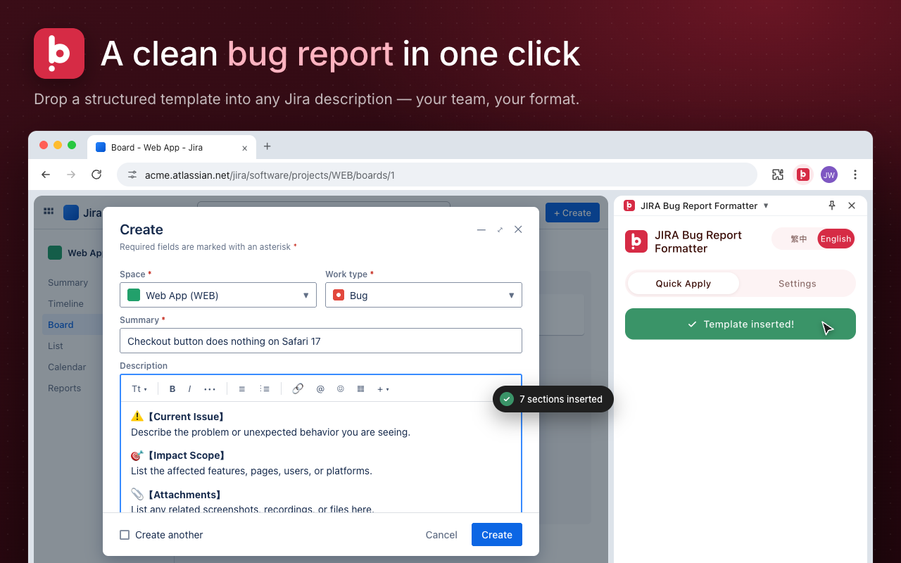
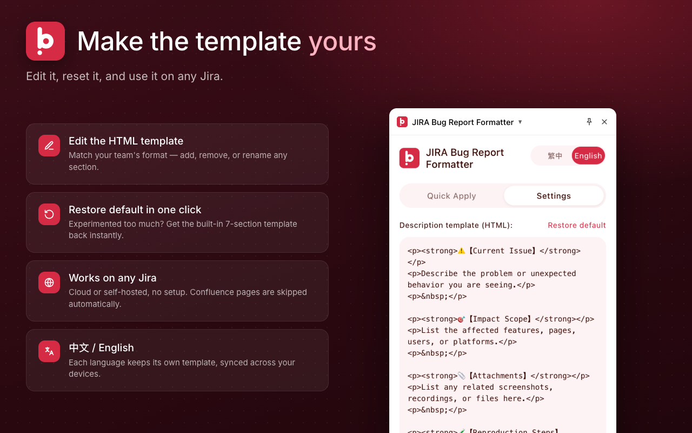

# JIRA Bug Report Formatter

Effortlessly produce structured JIRA bug reports with a single click. This Chrome extension injects a customizable HTML template directly into the ticket description so teams can capture consistent details without repetitive copy-and-paste work.

Relevant Link 😊: [Bug-Report-Formatter](https://chromewebstore.google.com/detail/jira-bug-report-formatter/mjfnjjkioaaebpdfhfdedlbbhnoinnec?authuser=0&hl=en&pli=1)

> Looking for the Traditional Chinese guide? See [README.zh-TW.md](README.zh-TW.md).



## Features

- **One-click template injection** – Populate the JIRA description field with a structured bug report template right from the side panel.
- **Focused default template** – Seven sections: Current Issue, Impact Scope, Attachments, Reproduction Steps, Expected Result, Test Environment, Additional Information.
- **Fully customizable content** – Edit the HTML template in Settings; one click on **Restore default** brings back the built-in version.
- **Works on any JIRA** – Cloud or self-hosted, no domain setup. Confluence pages (`/wiki/`) are skipped automatically.
- **Bilingual UI** – Switch between Traditional Chinese and English; each language keeps its own template.
- **Minimal permissions** – Uses only `storage`, `sidePanel`, and `scripting`. Site access is used only when you click **Apply**, and only on the current tab. All data stays in the browser.

## Installation

**From the Chrome Web Store (recommended):** install via the [store listing](https://chromewebstore.google.com/detail/jira-bug-report-formatter/mjfnjjkioaaebpdfhfdedlbbhnoinnec).

**From source:**

1. Clone this repository:
   ```bash
   git clone https://github.com/JulianWangHZ/JIRA-BugReport-Formatter.git
   ```
   Then run `npm ci && npm run build` (Node.js 22+). Or download the zip from the latest [GitHub Release](https://github.com/JulianWangHZ/JIRA-BugReport-Formatter/releases/latest) and unzip it.
2. Open `chrome://extensions/` in Chrome.
3. Enable **Developer mode** in the top-right corner.
4. Click **Load unpacked** and select the `build/` folder (or the unzipped release folder).
5. The “JIRA Bug Report Formatter” icon will appear in your toolbar.

## Usage

1. Navigate to any JIRA ticket creation or edit page.
2. Open the extension side panel from the Chrome toolbar.
3. In the **Quick Apply** tab, click **Apply Bug Report Template**.
4. The description field is filled with the template; fill in the details and create the ticket.

## Configuration

Switch to the **Settings** tab in the side panel. It has one field, the description template, and the editor fills the panel height.



- **Description Template** – Edit the HTML directly and click **Save Settings**. Click **Restore default** to reset the current language's template instantly.

All settings are stored in Chrome Sync Storage, so they follow you across devices signed into the same account.

No domain setup is needed. The **JIRA Domains** and **Blocked Domains** fields from v1.x were removed; their saved values are kept but no longer read.

## Troubleshooting

- **“⚠️ Cannot run on chrome:// pages”** – Chrome blocks extensions on internal pages. Switch to a regular JIRA tab and try again.
- **“⚠️ This is a Confluence page”** – The URL path contains `/wiki/`, so the template is not applied. Open the JIRA issue instead.
- **Template does not appear** – Make sure you are on a JIRA create or edit page (not Confluence) and the page has finished loading.
- **Still seeing an old template after an update** – A previously saved template takes priority over the new default. Open **Settings** and click **Restore default**.

## Development

Written in TypeScript; `tsc` compiles `src/` to `build/` with no bundler.

```
src/
  background/service-worker.ts   Opens the side panel on toolbar click
  page/fill-description.ts       Runs in the JIRA tab; finds and fills the description field
  shared/                        Languages, UI strings, default templates, settings + storage
  sidepanel/                     Side panel markup, styles and controllers (entry: main.ts)
tests/                           Vitest + jsdom
```

| Command | What it does |
|---|---|
| `npm run build` | Compile to `build/` and copy manifest, HTML, CSS, icons |
| `npm test` | Run tests |
| `npm run test:coverage` | Run tests with an 80% coverage gate |
| `npm run typecheck` | Type-check `src/` and `tests/` |

After `npm run build`, reload the extension from `chrome://extensions/`.

`fill-description.ts` is sent to the page with `chrome.scripting.executeScript({ func })`, so it must stay self-contained (no imports or outer variables). A test guards this.

### Releases

Releases are automated with GitHub Actions:

- **Pull requests** (`.github/workflows/pr-check.yml`) – validate `manifest.json`, syntax-check scripts, and preview the next version in the job summary.
- **Merge to `main`** (`.github/workflows/release.yml`) – bump `manifest.json`, tag `vX.Y.Z`, and publish a GitHub Release with the packaged zip.

The version bump follows [Conventional Commits](https://www.conventionalcommits.org/) since the last tag:

| Commit / PR title | Bump |
|---|---|
| `feat!: ...` or `BREAKING CHANGE:` | major |
| `feat: ...` | minor |
| anything else (`fix:`, `refactor:`, ...) | patch |

Changes that only touch docs, `store-assets/`, or `.github/` don't trigger a release. Uploading to the Chrome Web Store is still manual — use the zip attached to the release.

## License

Released under the MIT License. See [`LICENSE`](LICENSE) for details.
