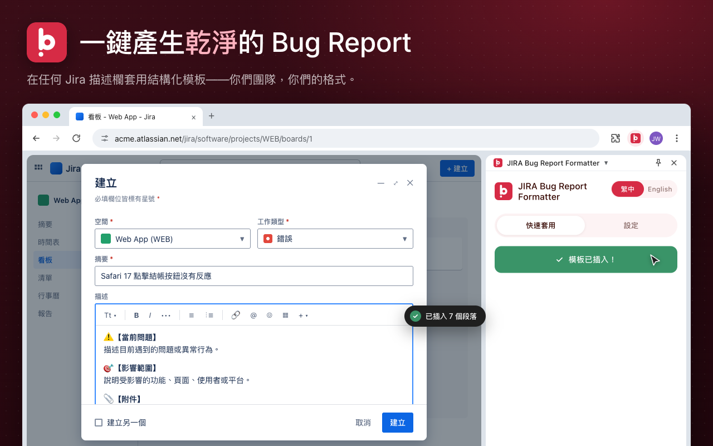
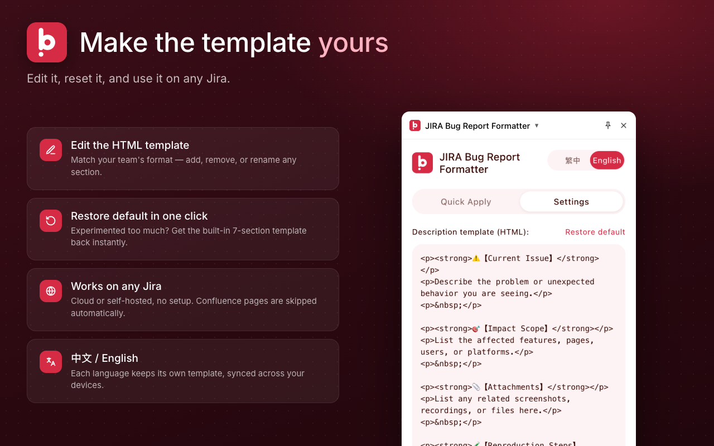

# JIRA Bug Report Formatter

JIRA Bug Report Formatter 是一款 Chrome 擴充功能，協助團隊以一致且結構化的方式撰寫 JIRA 錯誤回報。透過側邊欄一鍵套用 HTML 模板，大幅縮短票單整理時間，並降低資訊遺漏的風險。

相關連結 😊: [Bug-Report-Formatter](https://chromewebstore.google.com/detail/jira-bug-report-formatter/mjfnjjkioaaebpdfhfdedlbbhnoinnec?authuser=0&hl=en&pli=1)

> 想閱讀英文版說明？請參考 [README.md](README.md)。



## 功能亮點

- **一鍵套用模板**：在 JIRA 票單頁面點擊「套用 Bug Report 模板」，立即填入結構化段落與提示文字。
- **精簡的預設模板**：七個段落——當前問題、影響範圍、附件、重現測試步驟、預期結果、測試環境、額外資訊。
- **可自訂描述內容**：於「設定」直接編輯 HTML 模板；點一下「還原預設」即可恢復內建版本。
- **任何 JIRA 都能用**：Cloud 或自架版本皆可，不需設定網域。Confluence 頁面（`/wiki/`）會自動略過。
- **中英雙語介面**：可切換繁體中文與英文，兩種語言各自保存一份模板。
- **權限最小化**：僅使用 `storage`、`sidePanel` 與 `scripting` 權限。只有在按下「套用」時才會存取目前分頁，資料只在瀏覽器端處理。

## 安裝方式

**從 Chrome 線上應用程式商店（建議）**：透過[商店頁面](https://chromewebstore.google.com/detail/jira-bug-report-formatter/mjfnjjkioaaebpdfhfdedlbbhnoinnec)安裝。

**從原始碼安裝：**

1. Clone 此儲存庫：
   ```bash
   git clone https://github.com/JulianWangHZ/JIRA-BugReport-Formatter.git
   ```
   接著執行 `npm ci && npm run build`（需 Node.js 22+）。或從最新的 [GitHub Release](https://github.com/JulianWangHZ/JIRA-BugReport-Formatter/releases/latest) 下載 zip 並解壓縮。
2. 在 Chrome 中開啟 `chrome://extensions/`。
3. 開啟右上角的 **Developer mode**。
4. 點擊 **Load unpacked**，選擇 `build/` 資料夾（或解壓縮後的 Release 資料夾）。
5. 載入成功後，工具列會出現「JIRA Bug Report Formatter」圖示。

## 基本使用流程

1. 進入任一 JIRA 票單建立或編輯頁面。
2. 從 Chrome 工具列開啟擴充功能側邊欄。
3. 於「快速套用」頁籤點擊「套用 Bug Report 模板」。
4. 描述欄位會自動填入模板，補上細節後建立票單即可。

## 設定說明

切換到側邊欄的「設定」頁籤。這裡只有一個欄位：描述模板，編輯區會撐滿整個側邊欄高度。



- **描述模板**：直接編輯 HTML 後按「儲存設定」。點「還原預設」會立即將目前語言的模板恢復為內建版本。

所有設定都儲存在 Chrome Sync Storage，登入同一帳號的裝置會自動同步。

不需要設定網域。v1.x 的「JIRA 網域」與「封鎖網域」欄位已移除，原本存下的資料會保留，但不再讀取。

## 疑難排解

- **「⚠️ 無法在 chrome:// 分頁中使用」**：Chrome 禁止擴充功能在內部頁面執行，請切換到一般 JIRA 分頁再試。
- **「⚠️ 這是 Confluence 頁面」**：網址路徑含有 `/wiki/`，所以不會套用模板。請改到 JIRA 的 issue 頁面操作。
- **模板沒有出現**：確認目前是 JIRA 建立或編輯 issue 的頁面（不是 Confluence），且頁面已載入完成。
- **更新後仍看到舊模板**：之前儲存過的模板會優先於新的預設值，請到「設定」點「還原預設」。

## 開發說明

使用 TypeScript 撰寫，由 `tsc` 將 `src/` 編譯到 `build/`，不使用 bundler。

```
src/
  background/service-worker.ts   點擊工具列圖示時開啟側邊欄
  page/fill-description.ts       在 JIRA 分頁中執行，尋找並填入描述欄位
  shared/                        語言、介面文字、預設模板、設定與儲存
  sidepanel/                     側邊欄 HTML、樣式與控制器（入口：main.ts）
tests/                           Vitest + jsdom
```

| 指令 | 用途 |
|---|---|
| `npm run build` | 編譯到 `build/`，並複製 manifest、HTML、CSS、圖示 |
| `npm test` | 執行測試 |
| `npm run test:coverage` | 執行測試並檢查 80% 覆蓋率門檻 |
| `npm run typecheck` | 型別檢查 `src/` 與 `tests/` |

`npm run build` 後，到 `chrome://extensions/` 重新載入擴充功能。

`fill-description.ts` 會透過 `chrome.scripting.executeScript({ func })` 送進頁面執行，必須保持自給自足（不可 import 或引用外部變數），已有測試把關。

### 自動發版

透過 GitHub Actions 自動化：

- **開 PR**（`.github/workflows/pr-check.yml`）：驗證 `manifest.json`、檢查腳本語法，並在 job summary 預告下一個版本號。
- **Merge 進 `main`**（`.github/workflows/release.yml`）：自動更新 `manifest.json` 版本號、打上 `vX.Y.Z` tag，並發布附帶打包 zip 的 GitHub Release。

版本號依上一個 tag 之後的 [Conventional Commits](https://www.conventionalcommits.org/) 決定：

| Commit / PR 標題 | 升版 |
|---|---|
| `feat!: ...` 或含 `BREAKING CHANGE:` | major |
| `feat: ...` | minor |
| 其他（`fix:`、`refactor:` 等） | patch |

只改文件、`store-assets/` 或 `.github/` 不會觸發發版。上架 Chrome 線上應用程式商店仍需手動上傳 Release 附帶的 zip。

## 授權

以 MIT License 釋出，詳見 [`LICENSE`](LICENSE)。
